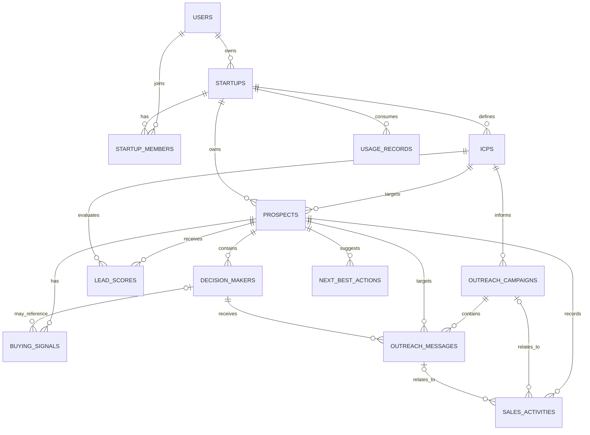

# BlueCode OS — Database Architecture

**Document:** `DATABASE_ARCHITECTURE.md`  
**Product:** BlueCode OS 
**Database:** MongoDB  
**ODM:** Mongoose  
**Architecture:** Multi-tenant MERN SaaS  
**External sales-data provider for MVP:** Apollo.io  
**Status:** Final MVP schema baseline  
**Collections:** 13

---

## 1. Purpose and scope

This document defines the MVP database contract: collections, document formats, field constraints, indexes, relationships, tenant-isolation rules, and operational expectations.

### 1.1 MVP workflow

1. A user creates or joins a startup workspace.
2. A workspace defines one or more Ideal Customer Profiles (ICPs).
3. The backend uses the configured Apollo integration to discover company prospects and decision-makers.
4. Prospects are scored against an ICP. Buying signals are stored only when supported by available evidence.
5. The AI generates outreach-message drafts.
6. An authorized workspace member reviews and approves messages before outbound execution.
7. Available Apollo sequence and activity information is synchronized where supported by the configured API access.
8. Sales activities are recorded and next-best-action recommendations are generated.
9. Provider usage and costs are recorded and checked against workspace limits.

Apollo is the only external sales-data provider in this MVP. Do not assume every signal, sequence operation, message event, or activity type is available to the configured Apollo account. Store only data that is actually returned or otherwise supported.

### 1.2 Conventions

- `ObjectId`: MongoDB BSON ObjectId.
- `Date`: BSON date stored in UTC.
- `string[]`: array of strings.
- `ObjectId[]`: array of MongoDB ObjectIds.
- `object`: structured object whose allowed keys must be validated by the application.
- Optional fields are marked with `?` in schema examples.
- `ref` indicates a logical Mongoose reference; it does not enforce foreign-key integrity or tenant ownership.
- Every tenant-owned document must contain `startupId`.
- Use Mongoose `timestamps: true` for mutable collections represented with `createdAt` and `updatedAt`. Append-only records may use only `createdAt`.
- Enums and validation rules below are the application contract. Implement them explicitly in Mongoose and service logic.

---

## 2. Collection inventory

| # | Collection | Responsibility | Tenant scope |
|---:|---|---|---|
| 1 | `users` | User identity and authentication | Global |
| 2 | `startups` | Workspace, plan, trial, and spend settings | Tenant root |
| 3 | `startupMembers` | User membership and workspace roles | Tenant-owned |
| 4 | `icps` | Ideal Customer Profile criteria | Tenant-owned |
| 5 | `prospects` | Company records discovered from Apollo | Tenant-owned |
| 6 | `decisionMakers` | Contacts associated with prospects | Tenant-owned |
| 7 | `leadScores` | Versioned prospect-to-ICP score history | Tenant-owned |
| 8 | `buyingSignals` | Evidence-backed buying signals | Tenant-owned |
| 9 | `outreachCampaigns` | Campaign configuration and Apollo sequence reference | Tenant-owned |
| 10 | `outreachMessages` | Drafts, approvals, and outbound status | Tenant-owned |
| 11 | `salesActivities` | Sales and synchronization event timeline | Tenant-owned |
| 12 | `nextBestActions` | AI-recommended actions | Tenant-owned |
| 13 | `usageRecords` | Provider usage and cost ledger | Tenant-owned |

A separate `leads` collection is not required for this MVP: `prospects` plus `leadScores` cover the initial qualification workflow. Replies and other supported activity events can be recorded in `salesActivities`; a separate `replies` collection is not included.

---

## 3. Shared constraints and tenant isolation

### 3.1 Tenant isolation

For every protected request:

1. Authenticate the user.
2. Resolve the active startup from trusted server-side session or membership context.
3. Verify that the user has an active `startupMembers` record for that startup.
4. Include `startupId` in every tenant-owned query.
5. Validate that every referenced document belongs to the same startup before reading or changing it.
6. Apply role checks for privileged actions such as workspace management, integration configuration, and approvals.

Correct query pattern:

```js
const prospect = await Prospect.findOne({
  _id: prospectId,
  startupId: req.startupId
});
```

Do not query tenant-owned records by `_id` alone. Mongoose `ref` and `populate()` do not automatically enforce tenant consistency.

### 3.2 General validation

- Reject malformed ObjectIds before querying.
- Trim required strings and enforce reasonable maximum lengths.
- Normalize user emails to lowercase.
- Validate enum values, numeric ranges, and nested object shapes.
- Never trust `startupId`, role, approval status, or ownership supplied by the client.
- Store password hashes, never plaintext passwords.
- Keep API credentials and secrets out of frontend code, API responses, logs, and error messages.
- Minimize stored provider responses; persist only the fields the product needs.
- Use server-generated timestamps and UTC dates.
- Paginate collection-list endpoints.
- Prefer status/archive transitions where historical sales records must remain available.

### 3.3 Index management

Create indexes through controlled migrations or deployment steps. Do not rely on automatic index creation in production. For optional external IDs, use partial unique indexes that apply only when the value exists and is a non-empty string. Confirm syntax against the installed MongoDB and Mongoose versions.

---

## 4. Collection schemas

The following shapes document the agreed application fields. Mongoose schemas should additionally specify `required`, `enum`, defaults, trimming, bounds, and index declarations as described below.

### 4.1 `users`

**Purpose:** Global user identity and authentication.

```ts
{
  _id: ObjectId,
  name: string,              // required
  email: string,             // required, unique, lowercase
  passwordHash: string,      // required
  status: string,            // required
  createdAt: Date,
  updatedAt: Date
}
```

**Constraints**
- `name`, `email`, `passwordHash`, and `status` are required.
- Normalize `email` to lowercase and validate its format.
- `passwordHash` must contain a secure password hash, never the original password.
- Define a finite `status` enum in the application, such as `active`, `pending_verification`, and `disabled`.
- Exclude `passwordHash` from normal API responses.

**Indexes**
- Unique: `{ email: 1 }`
- Optional: `{ status: 1 }` if administrative status queries need it.

### 4.2 `startups`

**Purpose:** Tenant/workspace settings, plan state, trial period, and API spending cap.

```ts
{
  _id: ObjectId,
  ownerUserId: ObjectId,      // required, ref: users
  name: string,               // required
  plan: string,               // required
  status: string,             // required
  trialEndsAt?: Date,
  apiSpendCap?: number,
  createdAt: Date,
  updatedAt: Date
}
```

**Constraints**
- `ownerUserId`, `name`, `plan`, and `status` are required.
- `ownerUserId` must reference an existing user.
- Define allowed `plan` and `status` values centrally.
- `trialEndsAt`, when present, must be a valid date.
- `apiSpendCap`, when present, must be a non-negative amount in a documented currency/unit.
- Enforce trial expiry, plan limits, and spending caps in backend policy logic; fields alone do not enforce them.
- Keep ownership consistent with `startupMembers`: the owner should have an active `owner` membership, or the service layer must document and enforce a single alternative source of truth.

**Indexes**
- `{ ownerUserId: 1 }`
- `{ status: 1 }`
- Optional: `{ trialEndsAt: 1 }` for trial-expiry processing.

### 4.3 `startupMembers`

**Purpose:** Many-to-many membership between users and startup workspaces.

```ts
{
  _id: ObjectId,
  startupId: ObjectId,        // required, ref: startups
  userId: ObjectId,            // required, ref: users
  role: string,                // required
  status: string,              // required
  createdAt: Date,
  updatedAt: Date
}
```

**Constraints**
- `startupId`, `userId`, `role`, and `status` are required.
- Define role values such as `owner`, `admin`, and `member`.
- Define status values such as `invited`, `active`, and `removed`.
- A user may have only one membership document per startup; update its status instead of inserting duplicates.
- Only active memberships authorize workspace access.
- Restrict invitations, role changes, integration configuration, and approvals according to role policy.

**Indexes**
- Unique: `{ startupId: 1, userId: 1 }`
- `{ userId: 1, status: 1 }`

### 4.4 `icps`

**Purpose:** Target-market criteria used to discover and evaluate prospects.

```ts
{
  _id: ObjectId,
  startupId: ObjectId,        // required, ref: startups
  name: string,               // required
  criteria: object,           // required
  criteriaVersion?: number,
  isActive?: boolean,
  createdBy: ObjectId,        // required, ref: users
  createdAt: Date,
  updatedAt: Date
}
```

**Constraints**
- `startupId`, `name`, `criteria`, and `createdBy` are required.
- Validate the allowed structure of `criteria`; do not accept arbitrary unbounded objects.
- Increment `criteriaVersion` whenever meaningful criteria change. Define its initial value and default in the application.
- Default `isActive` consistently, normally to `true`.
- `createdBy` must be an authorized member of the same startup.
- Translate ICP criteria into only those Apollo filters supported by the configured API access.

**Recommended criteria structure**

```ts
{
  industries?: string[],
  countries?: string[],
  regions?: string[],
  employeeRanges?: string[],
  revenueRanges?: string[],
  technologies?: string[],
  companyKeywords?: string[],
  excludedIndustries?: string[],
  excludedCompanies?: string[],
  targetJobTitles?: string[],
  targetSeniority?: string[],
  contactLocations?: string[]
}
```

This is the recommended shape of the `criteria` object, not an additional collection.

**Indexes**
- `{ startupId: 1, isActive: 1 }`
- `{ startupId: 1, createdAt: -1 }`

### 4.5 `prospects`

**Purpose:** Company-level records discovered from Apollo and evaluated by the product.

```ts
{
  _id: ObjectId,
  startupId: ObjectId,        // required, ref: startups
  icpId: ObjectId,            // required, ref: icps
  apolloOrganizationId?: string,
  name: string,               // required
  domain?: string,
  status: string,              // required
  createdAt: Date,
  updatedAt: Date
}
```

**Constraints**
- `startupId`, `icpId`, `name`, and `status` are required.
- `icpId` must refer to an ICP belonging to the same startup.
- Define allowed prospect states centrally, for example `discovered`, `qualified`, `enriched`, `in_sequence`, `replied`, `meeting`, `disqualified`, and `do_not_contact`.
- Normalize `domain` to lowercase and remove protocol, path, and trailing slash for matching.
- Use `apolloOrganizationId` as the preferred external deduplication key when available.
- A `do_not_contact` prospect must be blocked from outbound operations unless an authorized, explicit policy permits a status change.
- **Current relationship decision:** each prospect has one required `icpId`. If the same company must be associated with multiple ICPs, revise this relationship before implementing that requirement; the current schema does not model many-to-many prospect-to-ICP membership.

**Indexes**
- Unique partial: `{ startupId: 1, apolloOrganizationId: 1 }` when `apolloOrganizationId` exists and is non-empty.
- `{ startupId: 1, icpId: 1, status: 1 }`
- `{ startupId: 1, domain: 1 }` (non-unique).

### 4.6 `decisionMakers`

**Purpose:** People/contacts associated with a company prospect.

```ts
{
  _id: ObjectId,
  startupId: ObjectId,        // required, ref: startups
  prospectId: ObjectId,       // required, ref: prospects
  apolloPersonId?: string,
  fullName: string,            // required
  jobTitle?: string,
  businessEmail?: string,
  linkedinUrl?: string,
  emailVerified?: boolean,
  outreachStatus: string,     // required
  createdAt: Date,
  updatedAt: Date
}
```

**Constraints**
- `startupId`, `prospectId`, `fullName`, and `outreachStatus` are required.
- `prospectId` must reference a prospect in the same startup.
- Use `apolloPersonId` as the preferred external deduplication key when available.
- Normalize `businessEmail` to lowercase and trim whitespace.
- Set `emailVerified` only when the available source explicitly supports verification; do not infer it from email presence.
- Define allowed outreach states centrally, such as `not_contacted`, `drafted`, `approved`, `in_sequence`, `replied`, and `do_not_contact`.
- A `do_not_contact` contact must not be added to outbound execution.

**Indexes**
- Unique partial: `{ startupId: 1, apolloPersonId: 1 }` when `apolloPersonId` exists and is non-empty.
- `{ startupId: 1, prospectId: 1 }`
- `{ startupId: 1, businessEmail: 1 }` (non-unique unless the product guarantees uniqueness).

### 4.7 `leadScores`

**Purpose:** Versioned score history for a prospect against a particular ICP.

```ts
{
  _id: ObjectId,
  startupId: ObjectId,        // required, ref: startups
  prospectId: ObjectId,       // required, ref: prospects
  icpId: ObjectId,            // required, ref: icps
  score: number,               // required, 0–100
  category: string,            // required
  explanation?: string,
  scoringVersion: string,      // required
  icpVersion: number,          // required
  scoredAt: Date,              // required
  createdAt: Date
}
```

**Constraints**
- All references must belong to the same startup.
- `score` must be between `0` and `100`.
- Define allowed categories, for example `high`, `medium`, and `low`, using documented thresholds.
- `scoringVersion` identifies the scoring algorithm version.
- `icpVersion` records which version of ICP criteria was used.
- Preserve score history by inserting a new record for a new scoring event rather than overwriting historical scores.
- Keep explanations evidence-based and avoid claiming that missing information is known.

**Indexes**
- `{ startupId: 1, prospectId: 1, scoredAt: -1 }`
- `{ startupId: 1, icpId: 1, score: -1 }`

### 4.8 `buyingSignals`

**Purpose:** Evidence-backed potential buying signals supported by available Apollo data.

```ts
{
  _id: ObjectId,
  startupId: ObjectId,        // required, ref: startups
  prospectId: ObjectId,       // required, ref: prospects
  decisionMakerId?: ObjectId, // optional, ref: decisionMakers
  signalType: string,          // required
  description: string,         // required
  evidence: object[],          // required
  confidence: number,          // required
  status: string,              // required
  detectedAt: Date,            // required
  createdAt: Date,
  updatedAt: Date
}
```

**Recommended evidence item**

```ts
{
  field: string,
  value: string
}
```

**Constraints**
- `startupId`, `prospectId`, `signalType`, `description`, `evidence`, `confidence`, `status`, and `detectedAt` are required in the supplied schema.
- `prospectId` and optional `decisionMakerId` must belong to the same startup; if a decision maker is provided, it must belong to that prospect.
- `evidence` must contain at least one meaningful supporting item. Validate allowed keys and bound the size of each item.
- `confidence` must be between `0` and `1` and should represent an explainable assessment, not fabricated certainty.
- Define signal types centrally, for example `company_growth`, `technology`, `leadership`, `contact_change`, `engagement`, and `other`.
- Define status values such as `active`, `stale`, and `dismissed`.
- Create a signal only when available Apollo fields or supported activity data provide evidence. Signal categories do not guarantee that Apollo exposes every corresponding data point.

**Indexes**
- `{ startupId: 1, prospectId: 1, detectedAt: -1 }`
- `{ startupId: 1, status: 1 }`

### 4.9 `outreachCampaigns`

**Purpose:** Product-side campaign configuration and optional reference to a sequence managed by Apollo.

```ts
{
  _id: ObjectId,
  startupId: ObjectId,        // required, ref: startups
  icpId: ObjectId,            // required, ref: icps
  name: string,                // required
  channel: string,             // required
  status: string,              // required
  apolloSequenceId?: string,
  createdBy: ObjectId,         // required, ref: users
  approvedBy?: ObjectId,       // optional, ref: users
  approvedAt?: Date,
  createdAt: Date,
  updatedAt: Date
}
```

**Constraints**
- `startupId`, `icpId`, `name`, `channel`, `status`, and `createdBy` are required.
- `icpId` must belong to the same startup.
- The MVP channel is `email`; reject unsupported channels until implemented.
- Define campaign states centrally, for example `draft`, `pending_approval`, `approved`, `active`, `paused`, `completed`, and `cancelled`.
- `createdBy` and optional `approvedBy` must be authorized members of the same startup.
- Record `approvedAt` only after a valid approval action.
- Revalidate campaign approval/state before activating an outbound operation.
- `apolloSequenceId` is an external provider identifier, not a MongoDB reference. Use it only if the connected Apollo API permissions support the relevant operation.

**Indexes**
- `{ startupId: 1, status: 1 }`
- `{ startupId: 1, createdAt: -1 }`
- `{ startupId: 1, apolloSequenceId: 1 }` (non-unique unless uniqueness is guaranteed by the integration contract).

### 4.10 `outreachMessages`

**Purpose:** Generated message drafts, human approval, and outbound execution status.

```ts
{
  _id: ObjectId,
  startupId: ObjectId,        // required, ref: startups
  campaignId: ObjectId,      // required, ref: outreachCampaigns
  prospectId: ObjectId,      // required, ref: prospects
  decisionMakerId: ObjectId, // required, ref: decisionMakers
  subject?: string,
  body: string,               // required
  approvalStatus: string,     // required
  approvedBy?: ObjectId,      // optional, ref: users
  approvedAt?: Date,
  status: string,             // required
  idempotencyKey: string,     // required
  apolloMessageId?: string,
  sentAt?: Date,
  createdBy: ObjectId,        // required, ref: users
  createdAt: Date,
  updatedAt: Date
}
```

**Constraints**
- All required fields in the schema must be present; `body` must be non-empty and length-limited.
- `campaignId`, `prospectId`, and `decisionMakerId` must belong to the same startup.
- The selected decision maker must belong to the selected prospect.
- For email, require a non-empty subject before sending.
- Define `approvalStatus` values centrally, such as `pending`, `approved`, `rejected`, and `revision_requested`.
- Define message `status` values centrally, such as `draft`, `ready`, `queued`, `sent`, `delivered`, `replied`, `bounced`, `failed`, and `cancelled`.
- `approvedBy` and `approvedAt` must be set only after a valid approval action.
- Before queueing or sending, re-check approval, active campaign state, tenant ownership, prospect/contact suppression status, and current message status.
- Enforce uniqueness/idempotency for the key within the startup, and do not blindly retry an external operation after an ambiguous timeout.
- `apolloMessageId` is an external identifier; persist it only when the provider returns a stable ID.
- Sanitize any provider errors recorded by the application. Do not store secrets in errors.

**Indexes**
- `{ startupId: 1, campaignId: 1, status: 1 }`
- `{ startupId: 1, decisionMakerId: 1, createdAt: -1 }`
- `{ startupId: 1, approvalStatus: 1 }`
- Unique: `{ startupId: 1, idempotencyKey: 1 }`
- Optional unique partial: `{ startupId: 1, apolloMessageId: 1 }` only if Apollo guarantees stable uniqueness.

### 4.11 `salesActivities`

**Purpose:** Timeline of sales events and supported provider-synchronized activity.

```ts
{
  _id: ObjectId,
  startupId: ObjectId,        // required, ref: startups
  prospectId: ObjectId,       // required, ref: prospects
  campaignId?: ObjectId,      // optional, ref: outreachCampaigns
  messageId?: ObjectId,       // optional, ref: outreachMessages
  activityType: string,       // required
  summary: string,             // required
  occurredAt: Date,            // required
  externalActivityId?: string,
  createdAt: Date
}
```

**Constraints**
- `startupId`, `prospectId`, `activityType`, `summary`, and `occurredAt` are required.
- Optional `campaignId` and `messageId`, and required `prospectId`, must belong to the same startup.
- Store only observed provider events or real product/user actions. Do not fabricate delivery, open, reply, or meeting events.
- Treat activities as append-only under normal operation.
- Deduplicate imported provider events when a stable external activity ID is available.
- Define allowed activity types centrally, for example `prospect_discovered`, `contact_enriched`, `score_updated`, `signal_detected`, `message_approved`, `sequence_added`, `message_sent`, `message_replied`, `meeting_opportunity`, `status_changed`, and `integration_error`.

**Indexes**
- `{ startupId: 1, occurredAt: -1 }`
- `{ startupId: 1, prospectId: 1, occurredAt: -1 }`
- Unique partial: `{ startupId: 1, externalActivityId: 1 }` when the external ID exists and is stable.

### 4.12 `nextBestActions`

**Purpose:** AI-generated recommendations for the next useful sales action.

```ts
{
  _id: ObjectId,
  startupId: ObjectId,        // required, ref: startups
  prospectId: ObjectId,       // required, ref: prospects
  actionType: string,          // required
  title: string,               // required
  priority: string,            // required
  status: string,              // required
  basedOnActivityIds?: ObjectId[],
  createdAt: Date,
  updatedAt: Date
}
```

**Constraints**
- `startupId`, `prospectId`, `actionType`, `title`, `priority`, and `status` are required.
- `prospectId` must belong to the same startup.
- Every ID in `basedOnActivityIds`, when supplied, must reference a `salesActivities` record in the same startup.
- Define action types centrally, for example `follow_up`, `send_reply`, `share_information`, `book_meeting`, `nurture`, `stop_outreach`, and `review_prospect`.
- Define priority values such as `low`, `medium`, and `high`, and status values such as `pending`, `accepted`, `dismissed`, `completed`, and `expired`.
- Recommendations should be explainable from known data/activity. A recommendation must never bypass approval or do-not-contact checks.

**Indexes**
- `{ startupId: 1, status: 1, priority: -1 }`
- `{ startupId: 1, prospectId: 1, createdAt: -1 }`

### 4.13 `usageRecords`

**Purpose:** Append usage events for Apollo and AI/LLM operations.

```ts
{
  _id: ObjectId,
  startupId: ObjectId,        // required, ref: startups
  provider: string,            // required
  operation: string,           // required
  status: string,              // required
  creditsConsumed?: number,
  costAmount?: number,
  occurredAt: Date,            // required
  createdAt: Date
}
```

**Constraints**
- `startupId`, `provider`, `operation`, `status`, and `occurredAt` are required.
- Provider values for the MVP should be restricted to the integrations actually used, initially Apollo and the configured LLM provider.
- Define status values centrally, for example `success`, `failed`, and `blocked`.
- `creditsConsumed` and `costAmount`, when present, must be non-negative.
- Document the currency/unit for `costAmount`. Distinguish estimated cost from provider-reported cost; never present an estimate as an exact charge.
- Record failed and budget-blocked operations where applicable.
- Do not invent provider credit consumption when the provider does not expose it; represent unknown values as absent.
- `usageRecords` is a ledger, not a budget lock. Before an expensive call, the backend must check and reserve available budget atomically or use another concurrency-safe mechanism.

**Indexes**
- `{ startupId: 1, occurredAt: -1 }`
- `{ startupId: 1, provider: 1, operation: 1, occurredAt: -1 }`

---

## 5. Relationship model

### 5.1 Relationship summary

| Parent | Child | Cardinality | Relationship field |
|---|---|---|---|
| `users` | `startups` | One user may own multiple startups | `startups.ownerUserId` |
| `users` | `startupMembers` | One user may have many memberships | `startupMembers.userId` |
| `startups` | `startupMembers` | One startup has many members | `startupMembers.startupId` |
| `startups` | `icps` | One-to-many | `icps.startupId` |
| `icps` | `prospects` | One-to-many in this schema | `prospects.icpId` |
| `startups` | `prospects` | One-to-many | `prospects.startupId` |
| `prospects` | `decisionMakers` | One-to-many | `decisionMakers.prospectId` |
| `prospects` | `leadScores` | One-to-many score history | `leadScores.prospectId` |
| `icps` | `leadScores` | One-to-many score history | `leadScores.icpId` |
| `prospects` | `buyingSignals` | One-to-many | `buyingSignals.prospectId` |
| `decisionMakers` | `buyingSignals` | One-to-many, optional signal reference | `buyingSignals.decisionMakerId` |
| `icps` | `outreachCampaigns` | One-to-many | `outreachCampaigns.icpId` |
| `outreachCampaigns` | `outreachMessages` | One-to-many | `outreachMessages.campaignId` |
| `prospects` | `outreachMessages` | One-to-many | `outreachMessages.prospectId` |
| `decisionMakers` | `outreachMessages` | One-to-many | `outreachMessages.decisionMakerId` |
| `prospects` | `salesActivities` | One-to-many | `salesActivities.prospectId` |
| `outreachCampaigns` | `salesActivities` | One-to-many, optional reference | `salesActivities.campaignId` |
| `outreachMessages` | `salesActivities` | One-to-many, optional reference | `salesActivities.messageId` |
| `prospects` | `nextBestActions` | One-to-many | `nextBestActions.prospectId` |
| `salesActivities` | `nextBestActions` | Many activities may support an action | `nextBestActions.basedOnActivityIds` |
| `startups` | `usageRecords` | One-to-many | `usageRecords.startupId` |

Additional user references:
- `icps.createdBy` → `users._id`
- `outreachCampaigns.createdBy` and `approvedBy` → `users._id`
- `outreachMessages.createdBy` and `approvedBy` → `users._id`
- `startups.ownerUserId` → `users._id`

### 5.2 Mermaid ER diagram



This is a logical relationship diagram. MongoDB does not automatically enforce these foreign-key relationships.

---

## 6. Critical cross-document constraintsF

Enforce these rules in service functions and tests, not only in field declarations:

1. **Tenant consistency:** every referenced document must belong to the active startup.
2. **Membership authorization:** only users with active membership may access workspace data; privileged operations require the appropriate role.
3. **Owner consistency:** keep `startups.ownerUserId` and the owner's `startupMembers` role/status consistent.
4. **Prospect–contact consistency:** an outreach message's `decisionMakerId` must belong to its `prospectId`.
5. **ICP consistency:** a prospect, lead score, and campaign must reference an ICP in the same startup.
6. **Campaign consistency:** an outreach message's campaign, prospect, and contact must be eligible for the same startup and campaign.
7. **Signal consistency:** a buying signal's optional decision maker must belong to its prospect.
8. **Action evidence:** every activity ID referenced by a next-best action must belong to the same startup.
9. **Approval before execution:** re-check message approval, campaign state, membership authorization, and do-not-contact status immediately before any outbound action.
10. **Idempotency and retries:** use the required message idempotency key and stable provider IDs where available. A timeout does not prove that Apollo failed to process a request; reconcile uncertain outcomes before retrying.
11. **Usage limits:** usage records must be written consistently, and spend limits must be enforced with concurrency-safe backend logic.
12. **Deletion and retention:** define cleanup/retention behavior for related records. Prefer status/archive transitions for sales history unless deletion is required by policy or law.

---

## 7. Data lifecycle

### 7.1 Prospect discovery and scoring

1. Translate the selected ICP criteria into supported Apollo search filters.
2. Fetch and normalize company records.
3. Deduplicate by `startupId` plus `apolloOrganizationId` when available; use normalized domain as a secondary matching aid.
4. Create/update the prospect with its startup and ICP references.
5. Score the prospect and insert a `leadScores` history record.
6. Enrich selected contacts when needed and allowed by budget.
7. Update relevant records' timestamps.

### 7.2 Buying signals

1. Evaluate only available Apollo fields and supported activity data.
2. Store the supporting evidence with each signal.
3. Do not treat a generic company attribute as proof of purchase intent.
4. If no supported signal exists, store no signal and continue scoring using other available criteria.
5. Apply documented staleness rules and preserve dismissed status/evidence.

### 7.3 Outreach

1. Generate and persist a draft in `outreachMessages`.
2. Keep it pending until an authorized user approves it.
3. Before queueing/sending, re-check approval, campaign state, tenant references, contact eligibility, and do-not-contact status.
4. Execute only through the provider capability confirmed for the configured Apollo account.
5. Persist external identifiers and observed statuses when available.
6. Record supported events in `salesActivities` without fabricating delivery, open, reply, or meeting events.
7. Prevent duplicate sends on retries using idempotency and reconciliation.

**Email-client boundary:** if the product's initial send action opens the user's email application with a `mailto:` link, that action is not equivalent to sending through Apollo. Record only the action the product can actually verify. Do not claim delivery or provider synchronization unless the relevant system confirms it.

### 7.4 Usage and spend guardrails

1. Record relevant Apollo/LLM operations, including failures and blocked operations where applicable.
2. Check the workspace plan and spend cap before expensive operations.
3. Reserve/authorize budget atomically before making concurrent paid requests.
4. Reconcile estimated and provider-reported usage when available.
5. If exact cost/credit data is unavailable, leave it absent or label it as an estimate rather than inventing a value.

---

## 8. Security and privacy requirements

- Hash passwords with a suitable password-hashing configuration.
- Keep Apollo and LLM credentials on the backend, outside source control, and never expose them to React clients.
- Use the configured environment secret for Apollo only on the server if that is the chosen MVP integration model. Do not store an integration token in these collections unless the product later adopts per-startup account connections.
- Apply authentication and startup membership authorization to protected endpoints.
- Use least-privilege provider permissions and verify the intended API operations are available.
- Minimize stored contact data and restrict access to it.
- Sanitize provider/AI errors and never log secrets or sensitive headers.
- Apply rate limits, timeouts, bounded retries with backoff, and idempotent handling for external operations.
- Keep `criteria`, `evidence`, and any other flexible objects schema-validated and size-bounded.
- Verify Apollo's current API access, sequence/activity capabilities, and commercial terms before customer-facing launch.

---

## 9. Implementation checklist

### Schemas and indexes

- [ ] Create the 13 Mongoose models listed in the collection inventory.
- [ ] Add enums, required fields, defaults, bounds, and timestamps.
- [ ] Add the indexes specified in this document.
- [ ] Test optional external-ID partial unique indexes.
- [ ] Enforce score, confidence, and usage numeric ranges.
- [ ] Enforce unique `{ startupId, userId }` membership and unique `{ startupId, idempotencyKey }` message keys.

### Tenant security

- [ ] A user in Startup A cannot read, update, or delete Startup B's records.
- [ ] Cross-tenant references are rejected.
- [ ] Inactive members cannot access workspace data.
- [ ] Only authorized roles can perform privileged actions and approvals.
- [ ] Owner and membership records remain consistent.

### Apollo and AI operations

- [ ] Credentials are server-only and never returned by API handlers.
- [ ] Duplicate company/contact imports are suppressed.
- [ ] Enrichment and LLM calls are gated by usage/budget checks.
- [ ] Provider failures, rate limits, and uncertain outcomes are handled safely.
- [ ] External IDs are persisted when actually returned and supported.
- [ ] Buying signals include evidence and are not fabricated.

### Outreach safety

- [ ] A message cannot be queued/sent without valid approval.
- [ ] A do-not-contact prospect/contact cannot enter outbound execution.
- [ ] Retry after timeout does not blindly duplicate an external action.
- [ ] Imported activities are deduplicated where stable IDs exist.
- [ ] AI recommendations never bypass approval or authorization checks.
- [ ] `mailto:` handoff is not misrepresented as confirmed sending or delivery.

### Usage limits

- [ ] Every relevant provider operation is recorded.
- [ ] Budget is checked before paid operations.
- [ ] Concurrent requests cannot bypass the spend cap.
- [ ] Estimates are distinguishable from provider-reported usage/cost.

---

## 10. Explicitly out of scope

The following are not separate collections in this MVP baseline:

- Separate `integrations` collection (the initial model uses backend-configured provider credentials rather than per-startup credential storage).
- Separate `leads` collection.
- Separate `replies` collection.
- Separate buying-signal provider collections.
- Separate subscription/payment ledger.
- Separate calendar/meeting collection.
- Separate generic audit-log collection.
- Separate durable integration-operation/job ledger.

Add these only when product requirements justify them. If the product later needs customer-specific Apollo OAuth connections, add an `integrations` collection rather than storing customer tokens in unrelated documents. If robust background retries and operation reconciliation become necessary, consider a durable operation/job collection.

---

## 11. Final decision

The MVP database baseline consists of **13 collections**:

`users`, `startups`, `startupMembers`, `icps`, `prospects`, `decisionMakers`, `leadScores`, `buyingSignals`, `outreachCampaigns`, `outreachMessages`, `salesActivities`, `nextBestActions`, and `usageRecords`.

The non-negotiable requirements are strict tenant isolation, same-tenant reference validation, evidence-backed intelligence, Apollo-only external sales data for this phase, usage tracking and spend enforcement, duplicate suppression, and human approval before outbound execution.

This document defines the logical database contract. Before release, verify actual Apollo fields, API permissions, sequence/activity capabilities, and commercial permissions for the chosen backend integration model.
