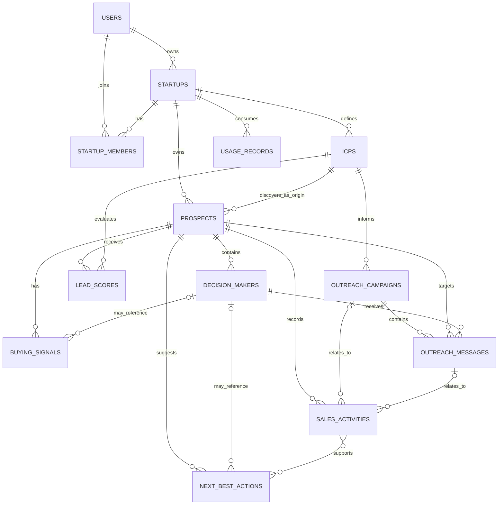

# BlueCode OS — Database Architecture

**Document:** `DB_ARCHITECTURE.md`
**Product:** BlueCode OS (AI Sales Copilot)
**Database:** MongoDB (replica set; a single-node replica set is sufficient)
**ODM:** Mongoose
**Architecture:** Multi-tenant MERN SaaS
**External sales-data provider for MVP:** Apollo.io (company/people search and enrichment only, capability-gated)
**Version:** 2.0, authoritative merged schema (matches the final ER diagram source)
**Status:** Final MVP schema baseline
**Collections:** 13

> Models, validators, DTOs, and migrations are generated from **this file only**. `DB_AMENDMENTS.md` is a historical change register and must not be used as a coding source.

---

## 1. Purpose and scope

This document defines the MVP database contract: collections, document formats, field constraints, enums, indexes, relationships, tenant-isolation rules, lifecycle rules, and operational expectations.

### 1.1 MVP workflow (draft-first, frozen decision D2)

1. A user creates or joins a startup workspace.
2. A workspace defines one or more Ideal Customer Profiles (ICPs).
3. When the `search_orgs` capability is enabled, the backend uses the configured Apollo integration to discover company prospects. When `search_people` and `enrich` are enabled it finds and enriches decision makers; otherwise contacts are added manually.
4. Prospects are scored against an ICP with a deterministic, versioned score. Buying signals are stored only when supported by evidence in stored data.
5. The AI generates outreach drafts for approved contacts.
6. An authorized workspace member reviews and approves each draft.
7. The founder opens the approved draft in their own email client through a `mailto:` handoff and may then mark it "sent by me".
8. The founder may paste replies they received; replies are classified and recorded.
9. Next-best-action recommendations are generated from recorded activity when the user opens the relevant page.
10. Provider usage and cost are recorded and checked against workspace limits.

**What the database records:** product events and user-reported events only. It never records provider-confirmed sending, delivery, opens, replies, sequence enrollment, or meetings in the MVP.

Apollo is the only external sales-data provider in this MVP. Do not assume every field or operation is available to the configured Apollo account. Store only data that is actually returned or entered by a user.

### 1.2 Conventions

- `ObjectId`: MongoDB BSON ObjectId.
- `Date`: BSON date stored in UTC.
- `string[]`: array of strings. `ObjectId[]`: array of ObjectIds.
- `object`: structured object whose allowed keys and sizes are validated by the application (Zod).
- Optional fields are marked with `?`.
- `ref` indicates a logical Mongoose reference; it does not enforce foreign-key integrity or tenant ownership.
- Every tenant-owned document contains `startupId`.
- Mutable collections use Mongoose `timestamps: true` (`createdAt`, `updatedAt`). Append-only collections have only `createdAt`.
- **Money is stored as integer paise (INR)** in `apiSpendCap`, `spendCommitted`, `spendReserved`, and `costAmount`.
- **Enums contain MVP values only.** Values for future features are added by migration when the feature is approved. They are not pre-declared (see §10).
- "Derived at read time" means the value is computed by the application and never stored.

### 1.3 Frozen decisions this schema encodes

| ID | Decision |
|---|---|
| D2 | Outbound = `mailto:` handoff; no server-side sending |
| D4 | Money = integer paise |
| D6 | Lead score is deterministic; AI writes explanations only |
| D10 | One prospect per company per startup; `prospects.icpId` is the immutable origin ICP; scores are per ICP |
| D14 | One evidence format with an allowlisted `field` and a stored `value` |
| D15 | Draft idempotency key and in-place regeneration |
| D16 | Campaign `active` is a product-side label |
| D18 | Enums hold MVP values only |

---

## 2. Collection inventory

| # | Collection | Responsibility | Tenant scope |
|---:|---|---|---|
| 1 | `users` | User identity and authentication | Global |
| 2 | `startups` | Workspace, plan, trial, spend cap and counters, settings | Tenant root |
| 3 | `startupMembers` | User membership and workspace roles | Tenant-owned |
| 4 | `icps` | Ideal Customer Profile criteria | Tenant-owned |
| 5 | `prospects` | Company records and firmographics | Tenant-owned |
| 6 | `decisionMakers` | Contacts associated with prospects | Tenant-owned |
| 7 | `leadScores` | Versioned prospect-to-ICP score history | Tenant-owned |
| 8 | `buyingSignals` | Evidence-backed buying signals | Tenant-owned |
| 9 | `outreachCampaigns` | Draft and approval containers | Tenant-owned |
| 10 | `outreachMessages` | Drafts, approval, handoff state | Tenant-owned |
| 11 | `salesActivities` | Timeline of recorded product and user events | Tenant-owned |
| 12 | `nextBestActions` | Recommended next actions | Tenant-owned |
| 13 | `usageRecords` | Provider usage and cost ledger | Tenant-owned |

A separate `leads` collection is not required: `prospects` plus `leadScores` cover qualification. Replies are `salesActivities` records; a separate `replies` collection is not included.

---

## 3. Shared constraints and tenant isolation

### 3.1 Tenant isolation

For every protected request:

1. Authenticate the user.
2. Read the requested startup from the `X-Startup-Id` header as a **hint** and resolve it server-side.
3. Verify that the user has an `active` `startupMembers` record for that startup, and that the startup status allows the request.
4. Include `startupId` in **every** tenant-owned query, update, delete, bulk write, and aggregation (as the first `$match`).
5. Validate that every referenced document belongs to the same startup before reading or changing it.
6. Apply permission checks for privileged actions (workspace management, approvals, clearing do-not-contact).

Correct query pattern:

```js
const prospect = await Prospect.findOne({
  _id: prospectId,
  startupId: req.ctx.startupId
});
```

Do not query tenant-owned records by `_id` alone. Mongoose `ref` and `populate()` do not enforce tenant consistency; do not use `populate()` on tenant-owned references. Load related documents through their own tenant-scoped repositories.

### 3.2 General validation

- Reject malformed ObjectIds before querying.
- Trim required strings and enforce the bounds in §3.4.
- Normalize emails to lowercase and validate format.
- Validate enum values, numeric ranges, and nested object shapes (Zod `.strict()`; unknown keys rejected).
- Never trust `startupId`, role, approval status, ownership, spend counters, or `source` supplied by the client.
- Store password hashes, never plaintext.
- Keep API credentials and secrets out of frontend code, API responses, logs, and error messages.
- Minimize stored provider responses; persist only fields the product uses.
- Use server-generated UTC timestamps.
- Paginate all list endpoints.
- Prefer status transitions over deletion where sales history must remain available.
- Reject client-controlled MongoDB operators and field paths (keys starting with `$` or containing `.`).

### 3.3 Index management

Create indexes through controlled migrations or deployment steps. Do not rely on automatic index creation in production (`autoIndex: false`). For optional external IDs and optional unique values, use **partial unique indexes** that apply only when the value exists and is a non-empty string. Confirm syntax against the installed MongoDB and Mongoose versions.

### 3.4 Field bounds (single reference)

| Field | Bound |
|---|---|
| `users.name`, `startups.name`, `icps.name`, `outreachCampaigns.name` | 1–80 chars |
| `users.email` | ≤ 254 chars |
| `prospects.name` | 1–200 chars |
| `prospects.domain` | ≤ 253 chars |
| `decisionMakers.fullName`, `jobTitle` | ≤ 120 chars |
| `businessEmail` | ≤ 254 chars |
| `linkedinUrl` | ≤ 300 chars, `http(s)` only |
| `icps.criteria` arrays | ≤ 25 items, each ≤ 80 chars |
| `firmographics.technologies`, `keywords` | ≤ 50 items, each ≤ 80 chars |
| `startups.settings.productSummary` | ≤ 1000 chars; other settings ≤ 200 chars |
| `leadScores.explanation` | ≤ 2000 chars |
| `leadScores.breakdown` | ≤ 12 keys; numeric values |
| `buyingSignals.description` | ≤ 500 chars |
| `buyingSignals.evidence` | 1–10 items; `field` ≤ 80; `value` ≤ 200 |
| `outreachMessages.subject` | ≤ 200 chars |
| `outreachMessages.body` | 1–5000 chars |
| `salesActivities.summary` | ≤ 500 chars |
| `salesActivities.metadata` | ≤ 2 KB serialized, allowlisted keys per `activityType` |
| `nextBestActions.title` | ≤ 200 chars; `reason` ≤ 500 chars |
| `usageRecords.operation`, `errorCode` | ≤ 80 chars |

---

## 4. Collection schemas

The shapes below are the agreed application fields. Mongoose schemas must additionally specify `required`, `enum`, defaults, trimming, bounds, and index declarations as described.

### 4.1 `users`

**Purpose:** Global user identity and authentication.

```ts
{
  _id: ObjectId,
  name: string,              // required
  email: string,             // required, unique, lowercase
  passwordHash: string,      // required, select:false
  status: string,            // required
  createdAt: Date,
  updatedAt: Date
}
```

**Enums**

| Field | Values |
|---|---|
| `status` | `active`, `pending_verification`, `disabled` |

**Constraints**
- `name`, `email`, `passwordHash`, and `status` are required.
- Normalize `email` to lowercase and validate its format.
- `passwordHash` holds a secure hash (argon2id, or bcrypt with cost ≥ 12), never the original password.
- Only `active` users can authenticate. `pending_verification` is reserved for a later email-verification flow; the MVP registers users as `active`.
- Exclude `passwordHash` from all queries by default (`select:false`) and from every API response.

**Indexes**
- Unique: `{ email: 1 }`

### 4.2 `startups`

**Purpose:** Tenant/workspace root: plan, trial period, API spend cap and counters, and workspace settings used for drafting.

```ts
{
  _id: ObjectId,
  ownerUserId: ObjectId,      // required, ref: users
  name: string,               // required
  plan: string,               // required
  status: string,             // required
  trialEndsAt?: Date,
  apiSpendCap: number,        // required, integer paise, >= 0
  spendCommitted: number,     // required, integer paise, default 0, >= 0
  spendReserved: number,      // required, integer paise, default 0, >= 0
  settings?: {
    calendarLink?: string,
    senderName?: string,
    senderTitle?: string,
    productSummary?: string
  },
  createdAt: Date,
  updatedAt: Date
}
```

**Enums**

| Field | Values |
|---|---|
| `plan` | `trial`, `starter`, `growth`, `pro` |
| `status` | `active`, `trial_expired`, `suspended` |

**Constraints**
- `ownerUserId`, `name`, `plan`, `status`, `apiSpendCap`, `spendCommitted`, and `spendReserved` are required.
- `ownerUserId` must reference an existing user and must match an active `owner` membership. Create the startup and the owner membership in **one transaction**.
- `apiSpendCap` is set from configuration at creation (`TRIAL_SPEND_CAP_PAISE` for trial plans). The trial value is **pending owner freeze** (D5). Backend, API, UI, and tests must read the same configured value.
- `spendCommitted` and `spendReserved` are changed **only** by atomic usage operations (Backend §10), never by generic updates or client input.
- Invariant: `spendCommitted + spendReserved ≤ apiSpendCap`, except a documented bounded overrun when a provider reports a cost higher than the estimate.
- `trialEndsAt`, when present, must be a valid date. For `plan='trial'`, it is set to creation time plus 15 days.
- `trial_expired` is detected lazily when `plan='trial'` and `now > trialEndsAt`, then persisted on first detection. In this state reads are allowed; writes and paid operations are rejected.
- `suspended` workspaces have no access.
- `settings` values are used only for draft generation and meeting-link text; `calendarLink` must be an `https` URL. The only link a draft may contain is this link.
- Plan limits and spend caps are enforced by backend policy logic; the fields alone enforce nothing.

**Indexes**
- `{ ownerUserId: 1 }`
- `{ status: 1 }`

### 4.3 `startupMembers`

**Purpose:** Many-to-many membership between users and startup workspaces.

```ts
{
  _id: ObjectId,
  startupId: ObjectId,        // required, ref: startups
  userId: ObjectId,           // required, ref: users
  role: string,               // required
  status: string,             // required
  createdAt: Date,
  updatedAt: Date
}
```

**Enums**

| Field | Values |
|---|---|
| `role` | `owner`, `admin`, `member` |
| `status` | `invited`, `active`, `removed` |

**Constraints**
- All fields are required.
- A user has at most one membership document per startup; update its status instead of inserting duplicates (re-inviting a `removed` member reactivates the same document).
- Only `active` memberships authorize workspace access. `invited` and `removed` do not.
- The last `owner` cannot be removed or demoted.
- Permissions are looked up from an explicit permission matrix (Backend §5.2), not from role ordering.

**Indexes**
- Unique: `{ startupId: 1, userId: 1 }`
- `{ userId: 1, status: 1 }`

### 4.4 `icps`

**Purpose:** Target-market criteria used to discover and evaluate prospects.

```ts
{
  _id: ObjectId,
  startupId: ObjectId,        // required, ref: startups
  name: string,               // required
  criteria: object,           // required
  criteriaVersion: number,    // required, default 1
  isActive: boolean,          // required, default true
  createdBy: ObjectId,        // required, ref: users
  createdAt: Date,
  updatedAt: Date
}
```

**Criteria structure** (not an additional collection)

```ts
{
  industries?: string[],
  countries?: string[],
  regions?: string[],
  employeeRanges?: string[],
  revenueRanges?: string[],
  technologies?: string[],
  companyKeywords?: string[],
  excludedIndustries?: string[],
  excludedCompanies?: string[],
  targetJobTitles?: string[],
  targetSeniority?: string[],
  contactLocations?: string[]
}
```

**Constraints**
- `startupId`, `name`, `criteria`, `criteriaVersion`, `isActive`, and `createdBy` are required.
- Validate the criteria structure with a strict schema; arrays hold ≤ 25 items of ≤ 80 chars each; reject unknown keys.
- `criteriaVersion` starts at 1 and is incremented by the service whenever criteria change. It is not client-writable.
- AI-proposed criteria are never saved automatically; the founder confirms them.
- `createdBy` must be an active member of the same startup.
- ICPs are archived (`isActive=false`), not deleted, because prospects, scores, and campaigns reference them.
- Translate criteria into only those Apollo filters supported by the configured API access; apply unsupported exclusions after results return.
- The number of active ICPs is limited by plan (`maxIcps`).

**Indexes**
- `{ startupId: 1, isActive: 1 }`
- `{ startupId: 1, createdAt: -1 }`

### 4.5 `prospects`

**Purpose:** Company-level records discovered through Apollo and evaluated by the product.

```ts
{
  _id: ObjectId,
  startupId: ObjectId,        // required, ref: startups
  icpId: ObjectId,            // required, ref: icps. ORIGIN ICP, immutable
  apolloOrganizationId?: string,
  name: string,               // required
  domain?: string,
  status: string,             // required
  firmographics?: {
    industry?: string,
    employeeCount?: number,
    country?: string,
    region?: string,
    revenueRange?: string,
    technologies?: string[],
    keywords?: string[],
    openJobCount?: number,        // only if verified as returned by Apollo
    latestFundingAt?: Date,       // only if verified as returned by Apollo
    latestFundingStage?: string   // only if verified as returned by Apollo
  },
  createdAt: Date,
  updatedAt: Date
}
```

**Enums**

| Field | Values |
|---|---|
| `status` | `discovered`, `qualified`, `disqualified`, `do_not_contact` |

**Constraints**
- `startupId`, `icpId`, `name`, and `status` are required.
- **One prospect per company per startup.** Deduplicate by `{startupId, apolloOrganizationId}` when available, then by normalized `domain`.
- `icpId` is the **origin ICP**: the ICP that first discovered the company. It is set at creation and **never updated**. If a later search through a different ICP finds the same company, the prospect stays as is and a new `leadScores` row is inserted for that other ICP.
- `icpId` must refer to an ICP in the same startup.
- Normalize `domain`: lowercase, remove protocol, path, `www.`-prefix handling per the shared normalizer, and trailing slash.
- `firmographics` holds only fields actually returned by Apollo or entered by a user. Absent values stay absent (never guessed). The three optional signal-related fields are used only after Apollo field verification (`APOLLO_INTEGRATION.md §3`).
- State rules (transition table in Backend §11.1):
  - `discovered → qualified` when the founder selects the prospect.
  - `discovered|qualified → disqualified` (re-opening to `qualified` is allowed).
  - Any state `→ do_not_contact`. Leaving `do_not_contact` requires the `prospect:clear_dnc` permission, a reason, and a `status_changed` activity.
- A `do_not_contact` prospect is blocked from drafting, approval, and handoff. Setting it also sets all its contacts to `do_not_contact`.
- Prospect state never depends on email delivery or replies.

**Indexes**
- Unique partial: `{ startupId: 1, apolloOrganizationId: 1 }` when `apolloOrganizationId` exists and is a non-empty string.
- `{ startupId: 1, icpId: 1, status: 1 }`
- `{ startupId: 1, domain: 1 }` (non-unique)
- `{ startupId: 1, status: 1, updatedAt: -1 }` (provisional; validate against final list queries before creating)

### 4.6 `decisionMakers`

**Purpose:** People/contacts associated with a company prospect.

```ts
{
  _id: ObjectId,
  startupId: ObjectId,        // required, ref: startups
  prospectId: ObjectId,       // required, ref: prospects
  apolloPersonId?: string,
  fullName: string,           // required
  jobTitle?: string,
  businessEmail?: string,
  linkedinUrl?: string,
  emailVerified?: boolean,
  source: string,             // required, default 'apollo'
  outreachStatus: string,     // required, default 'not_contacted'
  createdAt: Date,
  updatedAt: Date
}
```

**Enums**

| Field | Values |
|---|---|
| `source` | `apollo`, `manual` |
| `outreachStatus` | `not_contacted`, `drafted`, `approved`, `do_not_contact` |

**Constraints**
- `startupId`, `prospectId`, `fullName`, `source`, and `outreachStatus` are required.
- `prospectId` must reference a prospect in the same startup.
- Use `apolloPersonId` as the external deduplication key when present.
- Normalize `businessEmail` to lowercase and trim whitespace; validate format.
- `emailVerified` is `true` **only** when Apollo explicitly reports a verified email status. Never infer it from email presence. Manually added contacts have `emailVerified=false`.
- `source='manual'` contacts are the supported fallback when search or enrichment capabilities are disabled or the budget is exhausted.
- `outreachStatus` meaning: `drafted` = a draft exists; `approved` = an approved draft exists. It says nothing about delivery or replies.
- A `do_not_contact` contact never enters drafting or handoff.
- A contact needs a `businessEmail` before a draft can be created.

**Indexes**
- Unique partial: `{ startupId: 1, apolloPersonId: 1 }` when `apolloPersonId` exists and is non-empty.
- `{ startupId: 1, prospectId: 1 }`
- `{ startupId: 1, businessEmail: 1 }` (non-unique)
- Unique partial: `{ startupId: 1, prospectId: 1, businessEmail: 1 }` when `businessEmail` exists (prevents duplicate manual adds on the same prospect).

### 4.7 `leadScores`

**Purpose:** Versioned score history for a prospect against a particular ICP. Append-only.

```ts
{
  _id: ObjectId,
  startupId: ObjectId,        // required, ref: startups
  prospectId: ObjectId,       // required, ref: prospects
  icpId: ObjectId,            // required, ref: icps
  score: number,              // required, integer 0–100
  category: string,           // required
  coverage: number,           // required, 0–1
  breakdown: object,          // required, component -> points
  explanation?: string,
  explanationSource: string,  // required
  scoringVersion: string,     // required
  icpVersion: number,         // required
  scoredAt: Date,             // required
  createdAt: Date
}
```

**Enums**

| Field | Values / thresholds |
|---|---|
| `category` | `hot` (90–100), `high` (70–89), `medium` (50–69), `low` (< 50) |
| `explanationSource` | `rules`, `ai` |

**Constraints**
- All references must belong to the same startup. `icpId` may differ from `prospects.icpId` (a prospect can be scored against several ICPs).
- `score` is an integer 0–100, computed **deterministically** (Backend §7.5). **AI never changes `score` or `category`**; it may only write `explanation` (`explanationSource='ai'`). The default explanation is rules-generated from `breakdown` (`explanationSource='rules'`).
- `breakdown` maps score components to points (industry, employee range, geography, technology, keywords, contact availability, signals), ≤ 12 keys.
- **Missing-data rule (intentional):** components whose inputs are missing are excluded and the total is rescaled over the available weight. `coverage` = available weight / 100 is stored with every score.
- If `coverage < 0.5`, `category` is capped at `medium` and the UI shows "limited data".
- `scoringVersion` identifies the scoring algorithm version; `icpVersion` records `icps.criteriaVersion` at scoring time.
- Preserve history: every scoring event inserts a new row; never overwrite.
- Explanations must be evidence-based and must not claim that missing information is known.

**Indexes**
- `{ startupId: 1, prospectId: 1, scoredAt: -1 }`
- `{ startupId: 1, icpId: 1, score: -1 }`
- `{ startupId: 1, prospectId: 1, icpId: 1, scoredAt: -1 }`

### 4.8 `buyingSignals`

**Purpose:** Evidence-backed potential buying signals derived from stored provider data.

```ts
{
  _id: ObjectId,
  startupId: ObjectId,        // required, ref: startups
  prospectId: ObjectId,       // required, ref: prospects
  decisionMakerId?: ObjectId, // optional, ref: decisionMakers
  signalType: string,         // required
  description: string,        // required
  evidence: object[],         // required, 1–10 items
  confidence: number,         // required, 0–1
  status: string,             // required
  detectedAt: Date,           // required
  createdAt: Date,
  updatedAt: Date
}
```

**Evidence item (single definition)**

```ts
{
  field: string,   // dotted path from the EVIDENCE_PATHS allowlist, e.g. 'firmographics.employeeCount'
  value: string    // stringified stored value at detection time, <= 200 chars
}
```

**Enums**

| Field | Values |
|---|---|
| `signalType` | `company_growth`, `technology`, `leadership`, `contact_change`, `other` |
| `status` (stored) | `active`, `dismissed` |
| `status` (derived at read time) | `stale` when `detectedAt` is older than `SIGNAL_STALE_DAYS` (default 45) |

**Constraints**
- `startupId`, `prospectId`, `signalType`, `description`, `evidence`, `confidence`, `status`, and `detectedAt` are required.
- `prospectId` and optional `decisionMakerId` belong to the same startup; if a decision maker is given, it belongs to that prospect.
- **Evidence rule:** `evidence` has at least one item. Each `field` must be in `EVIDENCE_PATHS` and exist in the prospect's stored data at detection time. Initial allowlist: `firmographics.employeeCount`, `firmographics.technologies`, `firmographics.keywords`; and only after Apollo verification: `firmographics.openJobCount`, `firmographics.latestFundingAt`, `firmographics.latestFundingStage`.
- **AI interaction:** the model may return only `evidenceFields` (names). The backend accepts a signal only if every named field exists in the stored data now, and copies `value` from stored data. Values are never taken from model output. A signal without valid evidence is rejected.
- `confidence` is between 0 and 1 and represents an explainable assessment, not fabricated certainty.
- A generic company attribute is not proof of purchase intent. If no supported evidence exists, store no signal.
- There is no `engagement` signal type in the MVP: no engagement data is collected.
- `dismissed` signals keep their evidence. Stale signals are excluded from scoring.

**Indexes**
- `{ startupId: 1, prospectId: 1, detectedAt: -1 }`
- `{ startupId: 1, status: 1 }`

### 4.9 `outreachCampaigns`

**Purpose:** Product-side container for drafts and approval. It does not run, schedule, or send anything.

```ts
{
  _id: ObjectId,
  startupId: ObjectId,        // required, ref: startups
  icpId: ObjectId,            // required, ref: icps
  name: string,               // required
  channel: string,            // required
  status: string,             // required
  createdBy: ObjectId,        // required, ref: users
  approvedBy?: ObjectId,      // optional, ref: users
  approvedAt?: Date,
  createdAt: Date,
  updatedAt: Date
}
```

**Enums**

| Field | Values |
|---|---|
| `channel` | `email` |
| `status` | `draft`, `pending_approval`, `approved`, `active`, `paused`, `completed`, `cancelled` |

**Constraints**
- `startupId`, `icpId`, `name`, `channel`, `status`, and `createdBy` are required.
- `icpId` belongs to the same startup. The MVP channel is `email`; reject others.
- `createdBy` and `approvedBy` must be active members of the same startup. `approvedBy` and `approvedAt` are set only by a valid approval action, server-side, by a user with `campaign:approve`.
- **State meanings (product-side labels only):**
  - `approved`: the founder approved the container; drafts may be approved and handed off.
  - `active`: set automatically the first time one of its messages is handed off. It does **not** mean a sequence is running, and nothing sends or schedules follow-ups automatically.
  - `paused`: blocks new drafts and handoffs. `completed` and `cancelled` are terminal; cancelling cancels unsent drafts.
- Re-validate campaign state before every handoff.
- Allowed transitions: `draft → pending_approval → approved → active ⇄ paused → completed`; any non-terminal state `→ cancelled`.

**Indexes**
- `{ startupId: 1, status: 1 }`
- `{ startupId: 1, createdAt: -1 }`

### 4.10 `outreachMessages`

**Purpose:** AI-generated message drafts, human approval, and the honest record of the `mailto:` handoff.

```ts
{
  _id: ObjectId,
  startupId: ObjectId,        // required, ref: startups
  campaignId: ObjectId,       // required, ref: outreachCampaigns
  prospectId: ObjectId,       // required, ref: prospects
  decisionMakerId: ObjectId,  // required, ref: decisionMakers
  step: number,               // required, 1–5, default 1
  revision: number,           // required, default 1
  subject?: string,
  body: string,               // required
  approvalStatus: string,     // required
  approvedBy?: ObjectId,      // optional, ref: users
  approvedAt?: Date,
  status: string,             // required
  idempotencyKey: string,     // required
  sentAt?: Date,
  createdBy: ObjectId,        // required, ref: users
  createdAt: Date,
  updatedAt: Date
}
```

**Enums**

| Field | Values |
|---|---|
| `approvalStatus` | `pending`, `approved`, `rejected`, `revision_requested` |
| `status` | `draft`, `ready`, `handed_off`, `user_reported_sent`, `cancelled` |

**Constraints**
- `body` is non-empty and ≤ 5000 chars. Email handoff requires a non-empty `subject`.
- `campaignId`, `prospectId`, and `decisionMakerId` belong to the same startup, and the contact belongs to the prospect.
- `step` numbers separate drafts the founder chooses to send (initial, follow-up draft #1, #2). They are **not** an automated sequence and nothing schedules them.
- **Approval:**
  - `approvedBy` and `approvedAt` are set only by a valid approval action (`message:approve`).
  - `status='ready'` requires `approvalStatus='approved'`.
  - **Any edit** to `subject` or `body` sets `approvalStatus='pending'`, `status='draft'`, and clears `approvedBy` and `approvedAt`.
- **Status meanings:**
  - `draft`: created or edited, not yet approved.
  - `ready`: approved and eligible for handoff.
  - `handed_off`: the founder asked to open their email client. **It does not prove anything was sent.**
  - `user_reported_sent`: the founder marked it "sent by me". `sentAt` holds that user-reported time. **It does not prove delivery.**
  - `cancelled`: only before handoff.
  - Transitions: `draft → ready → handed_off → user_reported_sent`; `draft|ready → cancelled`. Repeating a handoff on a `handed_off` message is allowed and records another activity.
- **Handoff re-check** immediately before returning handoff data: approval, message status, campaign state (`approved|active`), tenant ownership, prospect and contact not `do_not_contact`, contact has `businessEmail`, subject and body non-empty.
- **Draft idempotency (D15):**
  - `idempotencyKey` is server-generated: `draft:{campaignId}:{decisionMakerId}:{step}`. Clients cannot set it.
  - `{startupId, idempotencyKey}` is unique. A repeated draft request for the same key returns the existing row.
  - Regeneration rewrites the **same row** in place (new `subject`/`body`, `revision += 1`, approval reset) and is allowed only while `approvalStatus != 'approved'`.
  - Concurrent identical requests: the service serializes by key in-process (single-flight) so only one LLM call is made; a duplicate-key error is a backstop and resolves to "load and return the existing row".
- Sanitize any provider error text recorded by the application; never store secrets.

**Indexes**
- `{ startupId: 1, campaignId: 1, status: 1 }`
- `{ startupId: 1, decisionMakerId: 1, createdAt: -1 }`
- `{ startupId: 1, approvalStatus: 1 }`
- Unique: `{ startupId: 1, idempotencyKey: 1 }`

### 4.11 `salesActivities`

**Purpose:** Append-only timeline of real product and user events.

```ts
{
  _id: ObjectId,
  startupId: ObjectId,        // required, ref: startups
  prospectId: ObjectId,       // required, ref: prospects
  campaignId?: ObjectId,      // optional, ref: outreachCampaigns
  messageId?: ObjectId,       // optional, ref: outreachMessages
  activityType: string,       // required
  summary: string,            // required
  classification?: {
    intent: string,
    confidence: number        // 0–1
  },
  metadata?: object,          // allowlisted keys per type, <= 2 KB
  occurredAt: Date,           // required
  createdAt: Date
}
```

**Enums**

| Field | Values |
|---|---|
| `activityType` | `prospect_discovered`, `contact_added`, `contact_enriched`, `score_updated`, `signal_detected`, `message_approved`, `handoff_requested`, `message_user_reported_sent`, `reply_logged`, `reply_classified`, `status_changed`, `integration_error` |
| `classification.intent` | `interested`, `buying_interest`, `not_now`, `wrong_person`, `referral`, `objection`, `unsubscribe`, `out_of_office`, `other` |

**Constraints**
- `startupId`, `prospectId`, `activityType`, `summary`, and `occurredAt` are required.
- `prospectId`, and optional `campaignId` and `messageId`, belong to the same startup.
- Append-only: no update or delete endpoints. Corrections are new activities.
- Record only real product or user actions. **Never** record delivery, open, bounce, provider-reply, sequence, or meeting events: the MVP cannot observe them.
- `reply_logged` is a reply the founder **pasted**; it is manually logged, not inbox synchronization. Such records carry `metadata.source='manual'`. `handoff_requested` carries `metadata.source='mailto'`. `message_user_reported_sent` carries `metadata.source='manual'`.
- `classification` appears only on `reply_classified` records. Confidence below 0.6 is stored as intent `other`.
- `metadata` keys are allowlisted per `activityType` and size-bounded.
- Deterministic side effects of a classified reply (e.g. `unsubscribe` sets do-not-contact) are applied by application code, not by the model, and each state change records `status_changed`.

**Indexes**
- `{ startupId: 1, occurredAt: -1 }`
- `{ startupId: 1, prospectId: 1, occurredAt: -1 }`

### 4.12 `nextBestActions`

**Purpose:** Explainable recommendations for the next useful sales action, shown when the user opens a page.

```ts
{
  _id: ObjectId,
  startupId: ObjectId,        // required, ref: startups
  prospectId: ObjectId,       // required, ref: prospects
  decisionMakerId?: ObjectId, // optional, ref: decisionMakers
  actionType: string,         // required
  title: string,              // required
  reason: string,             // required
  priority: string,           // required
  status: string,             // required
  dueAt?: Date,
  expiresAt?: Date,
  basedOnActivityIds?: ObjectId[],
  createdAt: Date,
  updatedAt: Date
}
```

**Enums**

| Field | Values |
|---|---|
| `actionType` | `follow_up`, `send_reply`, `share_information`, `book_meeting`, `nurture`, `stop_outreach`, `review_prospect` |
| `priority` | `low`, `medium`, `high` |
| `status` (stored) | `pending`, `accepted`, `dismissed`, `completed` |
| `status` (derived at read time) | `expired` when `expiresAt` has passed |

**Constraints**
- `startupId`, `prospectId`, `actionType`, `title`, `reason`, `priority`, and `status` are required.
- `prospectId` and optional `decisionMakerId` belong to the same startup (and the contact to the prospect).
- Every ID in `basedOnActivityIds` references a `salesActivities` record in the same startup.
- **These are recommendations, not automation.** The system does not send follow-ups, detect missing replies on its own, or book meetings. Rules produce the action (e.g. positive reply → `book_meeting`; handoff with no logged reply after N days → `follow_up`); wording is templated, with optional best-effort AI phrasing.
- Accepting an action performs no outbound operation. It only routes the user to the approval-gated flow.
- A recommendation never bypasses approval, authorization, or do-not-contact checks.
- At most one `pending` action per `(prospectId, actionType)`.

**Indexes**
- `{ startupId: 1, status: 1, priority: -1 }`
- `{ startupId: 1, prospectId: 1, createdAt: -1 }`

### 4.13 `usageRecords`

**Purpose:** Append-only ledger of Apollo and LLM operations.

```ts
{
  _id: ObjectId,
  startupId: ObjectId,        // required, ref: startups
  provider: string,           // required
  operation: string,          // required
  status: string,             // required
  creditsConsumed?: number,
  costAmount?: number,        // integer paise
  costType: string,           // required
  errorCode?: string,
  requestId?: string,
  entityRef?: {
    kind: string,
    id: string
  },
  occurredAt: Date,           // required
  createdAt: Date
}
```

**Enums**

| Field | Values |
|---|---|
| `provider` | `apollo`, `llm` |
| `status` | `success`, `failed`, `blocked` |
| `costType` | `estimated`, `reported` |
| `operation` (examples) | `apollo.org_search`, `apollo.people_search`, `apollo.enrich`, `llm.icp_extract`, `llm.explain_score`, `llm.signal_interpret`, `llm.draft_message`, `llm.classify_reply`, `llm.nba_wording` |

**Constraints**
- `startupId`, `provider`, `operation`, `status`, `costType`, and `occurredAt` are required.
- `creditsConsumed` and `costAmount`, when present, are non-negative; `costAmount` is integer paise.
- `costType='estimated'` unless the provider reports cost. Never present an estimate as an exact charge. A conservative estimate committed after a provider timeout is a **policy choice**, labeled `estimated` with `errorCode='PROVIDER_TIMEOUT'`; it is not proof that the provider charged that amount.
- Record failed and budget-blocked operations (`status='failed'|'blocked'`).
- Do not invent credit consumption; represent unknown values as absent.
- `requestId` links the row to the API request; `entityRef` links it to the affected document.
- `usageRecords` is a ledger, **not a budget lock**. Budget is reserved atomically on `startups` (`spendReserved`) before an expensive call and committed with a ledger row inside a transaction (Backend §10).
- Reconcile weekly: `startups.spendCommitted` should equal the sum of the startup's ledger `costAmount` for `success` and `failed` rows. Drift is a bug to investigate.
- Entitlement counts (prospects, DM searches, drafts) are computed from entities and ledger rows. They are soft limits; the spend cap is the hard limit.

**Indexes**
- `{ startupId: 1, occurredAt: -1 }`
- `{ startupId: 1, provider: 1, operation: 1, occurredAt: -1 }`

---

## 5. Relationship model

### 5.1 Relationship summary

| Parent | Child | Cardinality | Relationship field |
|---|---|---|---|
| `users` | `startups` | One user may own multiple startups | `startups.ownerUserId` |
| `users` | `startupMembers` | One user may have many memberships | `startupMembers.userId` |
| `startups` | `startupMembers` | One startup has many members | `startupMembers.startupId` |
| `startups` | `icps` | One-to-many | `icps.startupId` |
| `startups` | `prospects` | One-to-many | `prospects.startupId` |
| `icps` | `prospects` | One-to-many (origin ICP, immutable) | `prospects.icpId` |
| `prospects` | `decisionMakers` | One-to-many | `decisionMakers.prospectId` |
| `prospects` | `leadScores` | One-to-many score history | `leadScores.prospectId` |
| `icps` | `leadScores` | One-to-many score history (any ICP, not only the origin) | `leadScores.icpId` |
| `prospects` | `buyingSignals` | One-to-many | `buyingSignals.prospectId` |
| `decisionMakers` | `buyingSignals` | One-to-many, optional | `buyingSignals.decisionMakerId` |
| `icps` | `outreachCampaigns` | One-to-many | `outreachCampaigns.icpId` |
| `outreachCampaigns` | `outreachMessages` | One-to-many | `outreachMessages.campaignId` |
| `prospects` | `outreachMessages` | One-to-many | `outreachMessages.prospectId` |
| `decisionMakers` | `outreachMessages` | One-to-many | `outreachMessages.decisionMakerId` |
| `prospects` | `salesActivities` | One-to-many | `salesActivities.prospectId` |
| `outreachCampaigns` | `salesActivities` | One-to-many, optional | `salesActivities.campaignId` |
| `outreachMessages` | `salesActivities` | One-to-many, optional | `salesActivities.messageId` |
| `prospects` | `nextBestActions` | One-to-many | `nextBestActions.prospectId` |
| `decisionMakers` | `nextBestActions` | One-to-many, optional | `nextBestActions.decisionMakerId` |
| `salesActivities` | `nextBestActions` | Many activities may support an action | `nextBestActions.basedOnActivityIds` |
| `startups` | `usageRecords` | One-to-many | `usageRecords.startupId` |

Every tenant-owned collection also references `startups` through `startupId`.

Additional user references:
- `icps.createdBy` → `users._id`
- `outreachCampaigns.createdBy` and `approvedBy` → `users._id`
- `outreachMessages.createdBy` and `approvedBy` → `users._id`
- `startups.ownerUserId` → `users._id`

### 5.2 Mermaid ER diagram



This is a logical relationship diagram. MongoDB does not enforce these foreign-key relationships; services do. For visual editing, keep the ER diagram source file in the repo (`docs/db/`) and update it together with this document.

---

## 6. Enum registry (single source for `config/constants.js`)

| Collection.field | Values |
|---|---|
| `users.status` | `active`, `pending_verification`, `disabled` |
| `startups.plan` | `trial`, `starter`, `growth`, `pro` |
| `startups.status` | `active`, `trial_expired`, `suspended` |
| `startupMembers.role` | `owner`, `admin`, `member` |
| `startupMembers.status` | `invited`, `active`, `removed` |
| `prospects.status` | `discovered`, `qualified`, `disqualified`, `do_not_contact` |
| `decisionMakers.source` | `apollo`, `manual` |
| `decisionMakers.outreachStatus` | `not_contacted`, `drafted`, `approved`, `do_not_contact` |
| `leadScores.category` | `hot`, `high`, `medium`, `low` |
| `leadScores.explanationSource` | `rules`, `ai` |
| `buyingSignals.signalType` | `company_growth`, `technology`, `leadership`, `contact_change`, `other` |
| `buyingSignals.status` | `active`, `dismissed` (`stale` derived) |
| `outreachCampaigns.channel` | `email` |
| `outreachCampaigns.status` | `draft`, `pending_approval`, `approved`, `active`, `paused`, `completed`, `cancelled` |
| `outreachMessages.approvalStatus` | `pending`, `approved`, `rejected`, `revision_requested` |
| `outreachMessages.status` | `draft`, `ready`, `handed_off`, `user_reported_sent`, `cancelled` |
| `salesActivities.activityType` | `prospect_discovered`, `contact_added`, `contact_enriched`, `score_updated`, `signal_detected`, `message_approved`, `handoff_requested`, `message_user_reported_sent`, `reply_logged`, `reply_classified`, `status_changed`, `integration_error` |
| `salesActivities.classification.intent` | `interested`, `buying_interest`, `not_now`, `wrong_person`, `referral`, `objection`, `unsubscribe`, `out_of_office`, `other` |
| `nextBestActions.actionType` | `follow_up`, `send_reply`, `share_information`, `book_meeting`, `nurture`, `stop_outreach`, `review_prospect` |
| `nextBestActions.priority` | `low`, `medium`, `high` |
| `nextBestActions.status` | `pending`, `accepted`, `dismissed`, `completed` (`expired` derived) |
| `usageRecords.provider` | `apollo`, `llm` |
| `usageRecords.status` | `success`, `failed`, `blocked` |
| `usageRecords.costType` | `estimated`, `reported` |

---

## 7. Critical cross-document constraints

Enforce these in service functions and tests, not only in field declarations:

1. **Tenant consistency:** every referenced document belongs to the active startup.
2. **Membership authorization:** only users with active membership access workspace data; privileged operations require the matching permission.
3. **Owner consistency:** `startups.ownerUserId` and the owner's `startupMembers` role/status stay consistent; the last owner cannot be removed.
4. **Prospect–contact consistency:** a message's `decisionMakerId` belongs to its `prospectId`.
5. **ICP consistency:** a prospect, lead score, and campaign reference an ICP in the same startup; `prospects.icpId` is never updated after creation.
6. **Campaign consistency:** a message's campaign, prospect, and contact belong to the same startup.
7. **Signal consistency:** a signal's optional contact belongs to its prospect, and every signal passes the evidence rule (§4.8).
8. **Action evidence:** every activity ID in `basedOnActivityIds` belongs to the same startup.
9. **Approval before handoff:** re-check message approval, message status, campaign state, membership authorization, and do-not-contact status immediately before returning handoff data.
10. **Edit resets approval:** any edit to a message's subject or body clears approval and returns it to `draft`.
11. **Draft idempotency:** one `(campaignId, decisionMakerId, step)` is one row; regeneration only before approval; concurrent requests produce one row and one LLM call.
12. **Score integrity:** `score` and `category` are written only by the deterministic scorer; AI cannot change them.
13. **Honest states:** no code path writes provider-confirmed states (§10). `handed_off` and `user_reported_sent` are never described as sent or delivered.
14. **Usage limits:** spend counters change only through atomic reserve/commit/release; `spendCommitted + spendReserved ≤ apiSpendCap`.
15. **Deletion and retention:** prefer status/archive transitions for sales history; define deletion on user request or by law separately.

---

## 8. Data lifecycle

### 8.1 Prospect discovery and scoring
1. Require the `search_orgs` capability. If disabled, discovery is unavailable (`CAPABILITY_DISABLED`). There is no manual company import in the MVP.
2. Translate the ICP criteria into supported Apollo filters.
3. Fetch one page (≤ 25) and normalize results (lowercase domain; absent fields stay absent).
4. Deduplicate by `{startupId, apolloOrganizationId}`, falling back to normalized `domain`.
   - **New:** insert with `icpId` = this ICP and `status='discovered'`; record `prospect_discovered`.
   - **Existing, same ICP:** refresh `firmographics` only.
   - **Existing, different origin ICP:** leave `icpId` unchanged; insert a score for this ICP.
5. Insert a deterministic `leadScores` row per (prospect, ICP) scored.
6. Write the `usageRecords` row for the Apollo call.

### 8.2 Contacts
1. With `search_people` enabled, find decision makers (saved without email, `source='apollo'`).
2. Enrich only selected contacts with `enrich` enabled and budget available; set `emailVerified` only on explicit verification.
3. Otherwise add contacts manually (`source='manual'`, `emailVerified=false`).

### 8.3 Buying signals
1. Evaluate only stored, evidence-eligible fields.
2. Store the evidence (`field` + `value`) with each signal.
3. Do not treat a generic company attribute as proof of purchase intent.
4. If no supported signal exists, store none and continue scoring on other criteria.
5. Compute staleness at read time; keep dismissed signals and their evidence.

### 8.4 Outreach (draft-first)
1. Generate and persist a draft (`approvalStatus='pending'`, `status='draft'`) for an eligible contact.
2. Edits reset approval. An authorized user approves; the message becomes `ready`.
3. Handoff: re-check everything (§7 item 9), return `{to, subject, body}`, set `handed_off`, record `handoff_requested`. The client builds the `mailto:` link.
4. The user may mark "sent by me": `user_reported_sent`, `sentAt`, and `message_user_reported_sent`.
5. Delivery, opens, replies, and bounces are not observed or inferred.

**Email-client boundary:** opening a `mailto:` link is a handoff to the user's own mail application. It is not a send through Apollo or any provider. Record only what the product can verify, and word the UI as "Opening your email app" and "Marked as sent by you".

### 8.5 Replies and recommendations
1. The founder pastes a reply → `reply_logged` (manual) → classification → `reply_classified`.
2. Deterministic effects: `unsubscribe` (also caught by a keyword pre-check) sets prospect and contact to `do_not_contact` and cancels unsent drafts; other intents create recommendations by rule.
3. When a user opens the recommendations or dashboard page, rule-based actions are refreshed. The system sends nothing and books nothing.

### 8.6 Usage and spend guardrails
1. Check capability, then entitlement, then reserve budget atomically (`startups`).
2. Call the provider; commit with a ledger row in a transaction, or release on definite failure.
3. On timeout, commit the conservative estimate labeled `estimated`.
4. On process start (single instance), reset `spendReserved` to 0 and log affected startups.
5. Reconcile `spendCommitted` against the ledger weekly.

---

## 9. Security and privacy requirements

- Hash passwords with argon2id (or bcrypt cost ≥ 12).
- Keep Apollo and LLM credentials on the backend in server environment variables, outside source control; never expose them to React clients, responses, or logs. The shared Apollo key never requires startups to provide their own key.
- Do not store integration tokens in these collections; per-startup connections would need a new `integrations` collection (deferred).
- Apply authentication and startup-membership authorization to all protected endpoints.
- Use least-privilege provider permissions and verify the intended API operations are actually available (`APOLLO_INTEGRATION.md`).
- Minimize stored contact data and restrict access to it; contact data is visible only to active members of the owning startup.
- Sanitize provider and AI errors; never log secrets or sensitive headers.
- Apply rate limits, timeouts, and bounded retries with backoff to external calls; never auto-retry paid calls.
- Treat prospect and reply text as untrusted input to the LLM (prompt-injection handling).
- Keep `criteria`, `evidence`, `breakdown`, `metadata`, and `settings` schema-validated and size-bounded.
- **Commercial permission:** a successful Apollo API call does not establish permission to serve multiple customer workspaces or to store and display Apollo data. Confirm Apollo's terms (`APOLLO_INTEGRATION.md §4`, C1–C3) before any non-founder customer uses live Apollo data.

---

## 10. Deferred items (not in the MVP schema)

These are **not** fields or enum values in the MVP. They are added by migration only after the matching feature is approved and its Apollo capability is verified and licensed.

| Deferred item | Needed for |
|---|---|
| `outreachCampaigns.apolloSequenceId`; campaign `settings.steps` | Apollo sequence execution |
| `outreachMessages.apolloMessageId`, `lastError`; statuses `queued`, `sent`, `delivered`, `replied`, `bounced`, `failed`, `send_unknown` | Provider-confirmed sending |
| `salesActivities.externalActivityId` with its unique partial index; types `sequence_added`, `message_sent`, `message_replied`, `meeting_opportunity` | Automatic activity synchronization |
| `prospects.status`: `enriched`, `in_sequence`, `replied`, `meeting`; `decisionMakers.outreachStatus`: `in_sequence`, `replied` | Sequence and meeting tracking |
| `buyingSignals.signalType` `engagement` | Engagement data |
| `prospects.researchSummary`, `researchedAt` | Company research (post-MVP) |
| `integrations` collection | Per-startup Apollo OAuth |
| Jobs / operation ledger collection | Background processing and reconciliation |
| Audit-log collection | Generic audit logging |
| Subscription/payment collection | Stripe billing |
| Calendar/meeting collection | Calendar integration |

If Apollo sequences are verified later, adopting them is a **deliberate product-scope change** (a new frozen decision), not a capability flag.

---

## 11. Implementation checklist

### Schemas and indexes
- [ ] Create the 13 Mongoose models listed in the collection inventory
- [ ] Enums match §6 exactly (MVP values only); defaults and bounds from §3.4
- [ ] Create all §4 indexes by migration with `autoIndex: false` in production
- [ ] Test all partial unique indexes (empty string and missing value cases)
- [ ] Enforce score (0–100 integer), confidence (0–1), coverage (0–1), and non-negative usage/spend ranges
- [ ] Enforce unique `{startupId, userId}` memberships and unique `{startupId, idempotencyKey}` drafts
- [ ] `passwordHash` has `select:false`
- [ ] `spend*` fields are not writable through generic repository updates

### Tenant security
- [ ] A user in Startup A cannot read, update, or delete Startup B's records
- [ ] Cross-tenant references are rejected on every create and update
- [ ] Inactive members (`invited`, `removed`) cannot access workspace data
- [ ] Only authorized roles can approve and clear do-not-contact
- [ ] Owner and membership records remain consistent; last owner protected
- [ ] Aggregations begin with `$match: { startupId }`

### Apollo and AI operations
- [ ] Credentials are server-only and never returned
- [ ] Duplicate company and contact imports are suppressed
- [ ] Disabled capabilities return the documented error before any budget is reserved
- [ ] Enrichment and LLM calls are gated by usage and budget checks
- [ ] Provider failures, rate limits, and timeouts handled safely (no automatic retry of paid calls)
- [ ] Buying signals include valid evidence; AI-proposed evidence validated against stored data
- [ ] AI never changes `score` or `category`

### Outreach safety
- [ ] A message cannot be handed off without valid approval
- [ ] Editing an approved message resets it to `pending` and `draft`
- [ ] A do-not-contact prospect or contact cannot be drafted or handed off
- [ ] Parallel identical draft requests produce one row and one LLM call
- [ ] Regeneration is rejected after approval
- [ ] `mailto:` handoff and "sent by me" are never presented as confirmed sending or delivery
- [ ] AI recommendations never bypass approval or authorization checks

### Origin ICP
- [ ] `prospects.icpId` cannot be updated after creation
- [ ] Re-running discovery through the same ICP creates no duplicates
- [ ] Discovery through a second ICP keeps the original `icpId` and adds a second-ICP score

### Usage limits
- [ ] Every provider operation (including failed and blocked) is recorded
- [ ] Budget is reserved atomically before paid operations
- [ ] Concurrent requests cannot exceed the spend cap
- [ ] Commit is idempotent; timeout commits an `estimated` cost; boot recovery zeroes `spendReserved`
- [ ] Ledger-versus-counter reconciliation reports zero drift after a mixed test run
- [ ] No code path writes a deferred value from §10

---

## 12. Explicitly out of scope

The following are not separate collections in this MVP baseline:

- Separate `integrations` collection (the MVP uses a backend-configured provider credential, not per-startup credential storage)
- Separate `leads` collection
- Separate `replies` collection
- Separate buying-signal provider collections
- Separate subscription/payment ledger
- Separate calendar/meeting collection
- Separate generic audit-log collection
- Separate durable integration-operation/job ledger

Add these only when product requirements justify them (see §10). If the product later needs customer-specific Apollo OAuth connections, add an `integrations` collection rather than storing customer tokens in unrelated documents.

---

## 13. Final decision

The MVP database baseline consists of **13 collections**:

`users`, `startups`, `startupMembers`, `icps`, `prospects`, `decisionMakers`, `leadScores`, `buyingSignals`, `outreachCampaigns`, `outreachMessages`, `salesActivities`, `nextBestActions`, and `usageRecords`.

The non-negotiable requirements are strict tenant isolation, same-tenant reference validation, evidence-backed intelligence, deterministic scoring, Apollo-only external sales data (capability-gated and unverified until proven), usage tracking with atomic spend enforcement, duplicate suppression, human approval before any handoff, and honest recording of only what the product can verify.

This document defines the logical database contract. Before release, verify actual Apollo fields, API permissions, and commercial permissions for the chosen backend integration model, and freeze the trial spend cap.